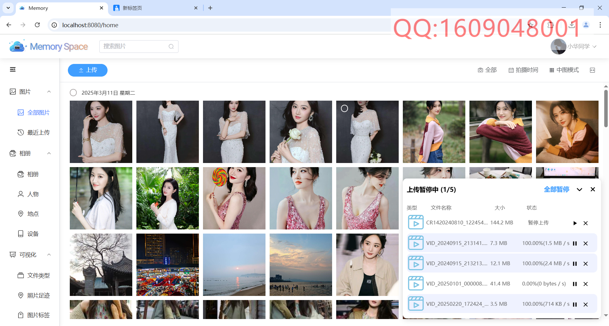
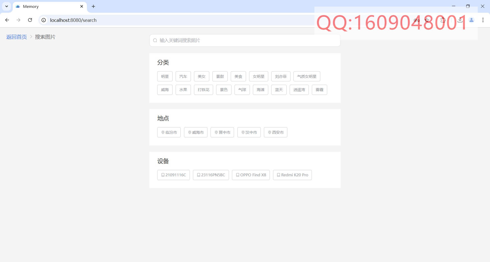
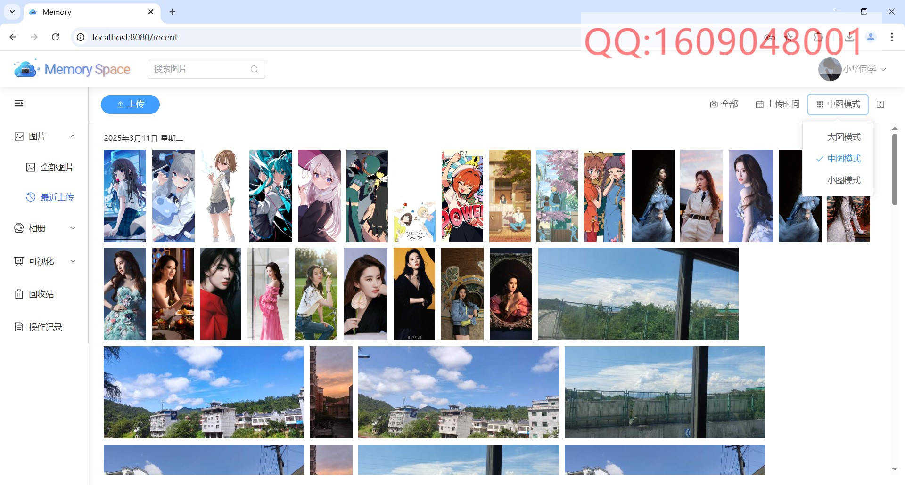
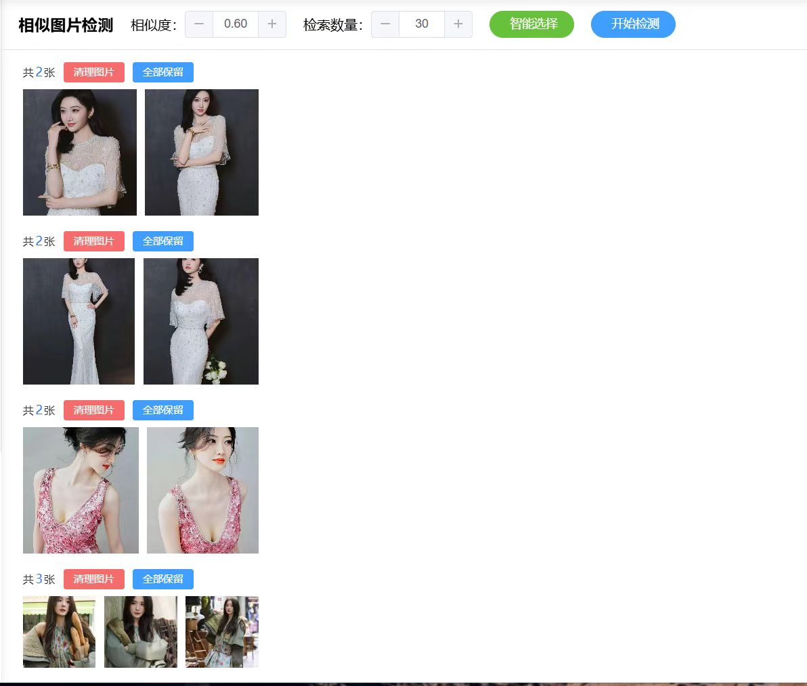
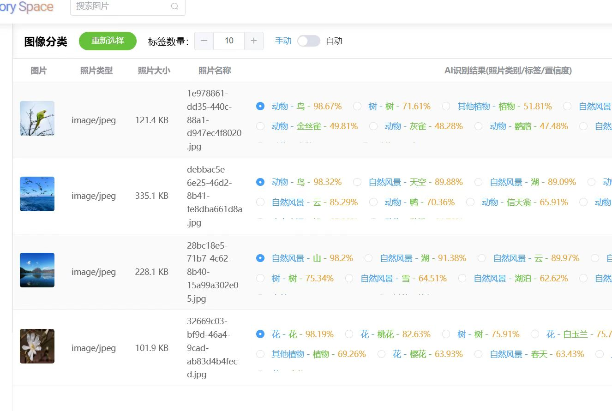
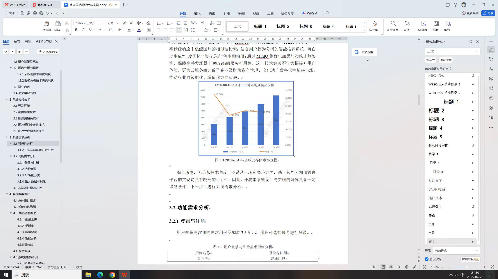

#### **一、项目概述**  

​	智能云相册是一款面向个人用户的云端影像管理系统，旨在通过**SpringBoot 3 + Vue 3**全栈技术实现照片、视频的存储、分类、检索与智能分析。系统整合**MinIO对象存储**、**MySQL 8**、**Redis缓存**及**OpenCV图像处理技术**，支持多维度元数据管理、智能分类与可视化展示，满足用户从上传到分享的全流程需求。项目聚焦技术实用性，适合作为毕业设计案例，体现全栈开发与AI技术融合能力。

---

#### **二、技术架构与核心模块**  

1. **后端架构** 
   • **SpringBoot 3**：提供RESTful API接口，通过JPA动态构建查询条件（如时间范围筛选），支持高并发请求处理。 
   • **MinIO分布式存储**：实现文件加密存储与断点续传，保障数据高可用性（如`file_object_name`字段加密路径）。 
   • **MySQL 8**：存储用户信息、文件元数据（如拍摄时间、设备参数）及操作记录，通过索引优化查询效率（如`date_time_original`索引加速时间检索）。 
   • **Redis缓存**：缓存热门文件元数据及用户会话信息，减少数据库压力，提升响应速度。 

2. **前端实现** 
   • **Vue 3 + ElementPlus**：构建响应式界面，支持图片缩放、比例调整（1:1/16:9）及瀑布流布局。 
   • **ECharts**：生成文件类型分布图、标签词云及地理足迹热力图，直观展示数据特征。 
   • **Vue Simple Uploader**：实现文件夹批量上传、实时进度显示与失败重试，优化大文件传输体验。  

3. **AI与图像处理** 
   • **OpenCV创新应用**： 
     ◦ 人物分类：通过人脸检测与128维特征向量提取，自动聚合同一人物照片（如`face`表存储特征向量）。 
     ◦ 元数据解析：提取EXIF信息（如设备型号、ISO、焦距）及GPS坐标，构建结构化元数据库（`image_meta_data`表）。 
   • **智能搜索**：支持按标签（如“风景”）、地点（省市/地标）、设备（如“iPhone 14 Pro”）多条件组合查询，后端通过动态SQL生成高效检索逻辑。  

---

#### **三、核心功能模块**  

1. **用户与存储管理** 
   • **账户系统**：支持登录、注册、密码修改及会员等级差异化容量管理（如普通用户5GB，VIP用户50GB）。 
   • **文件操作**： 
     ◦ **上传**：支持文件夹上传、批量断点续传，实时进度条显示（基于全局组件`Vue Simple Uploader`）。 
     ◦ **下载**：批量文件打包为ZIP压缩包，减少多次请求开销。 
     ◦ **回收站**：删除文件保留30天，支持一键恢复或永久清理。  

2. **智能分类与元数据展示** 
   • **多维分类**： 
     ◦ **人物相册**：基于OpenCV人脸识别自动归类，支持自定义命名（如“家庭合影”）。 
     ◦ **地理足迹**：解析GPS坐标生成地图标记，按省市筛选照片（如`location`表存储详细地址）。 
     ◦ **设备档案**：展示拍摄设备型号、镜头参数（如光圈、曝光时间）及文件格式分布。 
   • **元数据透传**：可视化呈现拍摄时间、文件大小、分辨率及地理位置（经纬度）。  

3. **相册与分享** 
   • **自定义相册**：用户可创建相册（如“2025西藏旅行”），自由添加/删除文件，设置封面与描述。 
   • **分享控制**：生成加密链接或二维码，支持1/7/30天有效期及权限管理（仅查看/可下载）。 

4. **数据可视化与操作追溯** 
   • **图表分析**：ECharts展示文件类型占比（如视频占30%）、标签高频词云（如“宠物”“旅行”）及存储容量使用趋势。 
   • **操作日志**：记录用户上传、下载、分享行为，支持时间范围筛选与导出（如`record`表存储操作详情）。  

---

#### **四、技术创新与实现亮点**  

1. **混合存储架构** 
   结合MinIO对象存储（海量文件）与MySQL关系型数据库（元数据管理），通过Redis缓存热门数据，实现高并发场景下的快速响应。  

2. **动态搜索优化** 
   • **前端交互**：采用智能联想输入框（如输入“海边”自动匹配“日落”），提升搜索体验。 
   • **后端逻辑**：基于`PictureQueryRequest`类动态生成SQL条件，支持编辑时间范围、设备型号等多维度筛选。  

3. **AI赋能影像管理** 
   • **人像识别**：通过OpenCV提取图像特征向量，计算余弦相似度实现相似图片检索。 
   • **标签自动化**：利用NLP技术分析图片内容，自动生成描述性标签（如“雪山”“聚会”）。 

